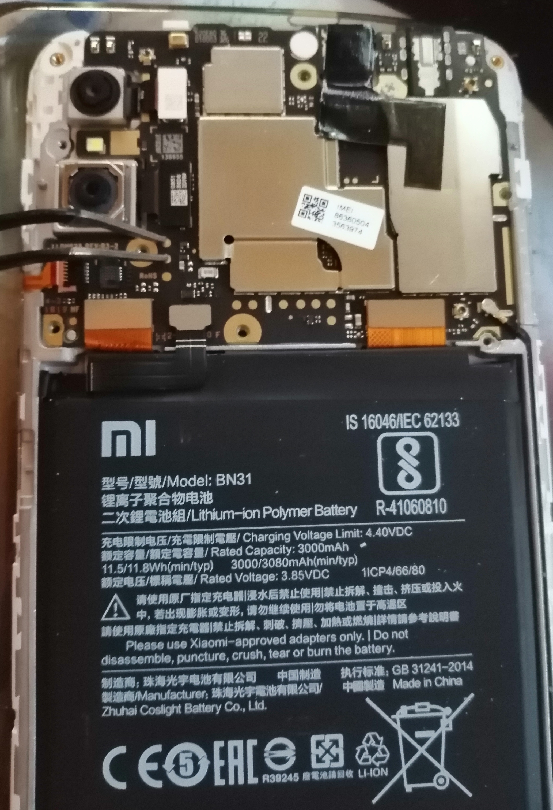

# Разблокировка загрузчика через EDL
Нужно что-нибудь НЕ МЕТАЛЛИЧЕСКОЕ (и не ногти) чтобы снять крышку, а также крестовая отвёртка

Нужен edlclient

ВЫРУБАЙ ТЕЛЕФОН
- Снимите заднюю крышку и верхнюю пластиковую хрень
- Соедините пины BOOT и 1.8V, не отпуская подключите кабель к компьютеру

- Прошивка devinfo
<a href="https://archive.org/download/yslbl/yslbl.bin" target="_blank" rel="noopener">
  <md-button variant="outlined">Скачать yslbl.bin</md-button>
</a>

```bash
edl w devinfo yslbl.bin
```

# lk2nd и postmarketOS
Нужен pmbootstrap

- Подключённый к компьютеру телефон надо перевести в ***FastbootD***

- Инициализация (Vendor: qcom | Device codename: msm8953)
```bash
pmbootstrap init
```
- Создание rootfs
```bash
pmbootstrap install
```

- Прошивка lk2nd
```bash
pmbootstrap flasher flash_lk2nd
```

- Прошивка postmarketOS
```bash
pmbootstrap flasher flash_rootfs
```

